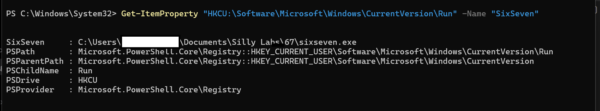

# MAAP Malware as a Prank

MAAP stands for **Malware as a Prank**. This is what I call MAAP, but everyone else would probably just call it prankware lol.

The idea is pretty straightforward. Install the `.exe` on your friend's computer, run it, and you're good. Whenever the user types **6 followed by 7** on their keyboard, the OG 67 sound plays. That's literally it.

## Demo (SOUND ON)

<video src="https://github.com/user-attachments/assets/af7f634b-a09c-4723-94b1-b090bbb7dacf" controls width="100%"></video>

## Versions

I'll be releasing two versions:

- **Persistent**: automatically starts again after a reboot.
- **Non-persistent**: once you close or kill it, it stays closed.

## Persistence

Here is the persistence check:

If you want to stop the program while it's running, just open Task Manager and end the process.

For the persistent version, killing the process does not completely remove it, so you'll need to properly uninstall it if you want it gone permanently.

## Privacy

This program does not send any information to a remote server.

No keyboard data, analytics, or other information is collected or transmitted anywhere. It only checks for the 6 and 7 key combination locally so it knows when to play the sound.

This is just a silly project for fun and learning. Please only install it on computers where you have permission to do so.

## Relevant MalDev Academy Modules I Used

- Module 155: Introduction to Keylogging
- Module 172: Introduction To Windows Persistence
- Module 173: Persistence Via The Windows Registry

## Disclaimer

This project might not be perfect. I avoided using AI a lot during the writing and development process because I was actually trying to learn, so it is probably super buggy and not perfect lol.
